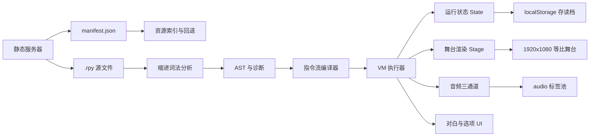

# GalGod 纯前端 Ren'Py (.rpy) 加载器实施计划

## 1. 结论与可行性

已解压的 `archive/` 目录是一份完整的 Ren'Py 工程源码（`.rpy` + 资源），**可以在浏览器里用纯 HTML/JS 复刻核心表现**：

- 画布固定 1920×1080（[`styles.rpy`](styles.rpy:10) 中 `gui.init(1920, 1080)`），可用 CSS `transform: scale()` 做等比缩放 + 黑边，天然适配 Ren'Py 的坐标体系。
- 剧本只用到 Ren'Py 语法的一个**有限子集**：`label / scene / show / hide / play / stop / voice / pause / with / $ / if / menu / jump / call / return / centered / call screen`，没有 `screen language` 的大规模动态脚本，也没有外部 Python 模块依赖。
- 图像资源是 `avif / webp / png`，现代浏览器全部原生支持；音频为 `ogg / mp3`，`<audio>` 可播；`movies/ed.webm` 用 `<video>`。
- 立绘通过 [`config/character_config.rpy`](config/character_config.rpy:2) 的 `CHARACTERS_CONFIG` 注册，每角色只有 `zoom / y_offset / expressions` 三个参数，浏览器端可直接用 CSS 变换对齐。

**因此方案是：浏览器运行时解析 `.rpy` 文本 → 编译成指令流 → VM 执行 → DOM 渲染**，不预编译、不依赖 Ren'Py 引擎、不引入任何 npm 依赖。

---

## 2. 目标范围

### 必须实现（游戏内引擎，等价表现）

| 能力 | 对应源文件 |
|---|---|
| 对白 / 旁白 / 打字机效果 / 名字框 | [`screens/dialogue_screens.rpy`](screens/dialogue_screens.rpy:12) |
| 立绘表情切换、位置、缩放、偏移、震动/跳跃 | [`config/character_core.rpy`](config/character_core.rpy:38) |
| 背景 / CG / SDCG / 纯色背景 / 雨效 / 黑幕遮罩 | [`resources.rpy`](resources.rpy:97)、[`effects/raineffect.rpy`](effects/raineffect.rpy:1) |
| 选项菜单（含问句形式） | [`screens/choice_screen.rpy`](screens/choice_screen.rpy:8) |
| 转场 dissolve / Dissolve(t) / fade / flash / vpunch / hpunch / pixellate | [`resources.rpy`](resources.rpy:224) |
| 音乐 / 音效 / 语音三通道，带 loop / fadein / fadeout | 剧本内 `play / stop / voice` |
| 记忆滤镜（灰化 / 泛黄）与 `camera master` | [`resources.rpy`](resources.rpy:232) |
| 存读档（3 页 × 6 槽 + 自动/快速） | [`screens/save_load.rpy`](screens/save_load.rpy:113) |
| 历史记录 + 回滚（滚轮上 / Back 按钮） | [`screens/history_screen.rpy`](screens/history_screen.rpy:12) |
| 章节跳转 / `jump` / `call` 返回栈 | [`script.rpy`](script.rpy:19) |
| `centered` 与 `call screen centered_left_text()` | [`resources.rpy`](resources.rpy:1) |
| ED 视频播放 | [`script.rpy`](script.rpy:6) |

### 第二阶段（系统 UI，功能等价、尽量还原视觉）

主菜单（[`screens/main_menu.rpy`](screens/main_menu.rpy:23)）、设置（[`screens/config.rpy`](screens/config.rpy:48)）、画廊（[`screens/gallery.rpy`](screens/gallery.rpy:142)）、作者的话（[`screens/other_screens.rpy`](screens/other_screens.rpy:71)）、退出确认（[`screens/quit_confirm_screen.rpy`](screens/quit_confirm_screen.rpy:1)）。

> 设置页是逐层叠加的图片 UI（`gui/config_menu.png` + 十余张分层图），**像素级还原成本极高**。计划采用「同样字段、同样布局、以图片为背景 + HTML 控件」的方式实现功能等价，并在计划末尾单独标注该取舍。

### 明确不做

- 不做 `.rpyc` 反编译（只读 `.rpy`）。
- 不做 Ren'Py 的开发者控制台、Steam 成就同步（`achievement.*` 落为 localStorage 解锁记录）。
- 不保证任意第三方 Ren'Py 游戏的兼容性，只保证本工程语法子集；解析器对未知语句「记录并跳过」，不会崩溃。

---

## 3. 已确认的关键约束与坑位

1. **无法列目录**：静态服务器不提供索引，必须依赖 `manifest.json`（由脚本扫描生成，属静态资源，不是运行时后端）。
2. **部分被引用图片缺失**：`gui/对话框.png`、`gui/YES_idle.png` 等在 `gui/` 列表中不存在。加载器需 `asset overrides` 机制回退到 `gui/textbox.png` / 纯 CSS 底板，并由校验脚本完整列出缺失项。
3. **BOM 与编码**：`resources.rpy`、`options.rpy`、`gui.rpy`、`script.rpy` 等文件带 UTF-8 BOM，解析前必须剥离 `\uFEFF`；文件名含中文，`fetch` 必须 `encodeURI`。
4. **缩进语法**：Ren'Py 用 4 空格缩进定义块，解析器必须基于缩进建树，不能用逐行正则硬解。
5. **Python 子集**：剧本中的 `$` 语句只有几类：actor 方法调用、变量自增/赋值、`renpy.pause/full_restart`、`achievement.*`、`persistent.*`、`config.*`。用自研小解释器（Pratt 表达式 + 白名单调用），**不使用 `eval` / `new Function`**，避免 CSP 与注入风险。
6. **语音路径**：`voice "cv/linxi/xxx.ogg"` 的实际文件在 `audio/cv/linxi/xxx.ogg`，需统一加 `audio/` 前缀。
7. **立绘偏移语义**：`yoffset` 是未随 `zoom` 缩放前、在 1080 高度坐标系下的像素偏移；顺序必须是「先定位 → 再 offset → 再 scale(origin: bottom center)」。
8. **`menu` 的问句形式**：`"???" "你喜欢吃的小零食是？"` 是菜单块内的 say 语句（作为菜单题面），不是选项；选项才是 `"文本":`。
9. **`show layer master at memory_filter` 与 `camera master at memory_filter` 等价**：都需要对 master 层整体加 CSS filter，并在 `reset_filter` 时清除。
10. **必须通过 HTTP 打开**：`file://` 下 `fetch` 会被浏览器拦截，需 `python3 -m http.server` 之类静态服务。

---

## 4. 目录结构

```
web/
  index.html                     # 唯一入口，无构建
  css/
    stage.css                    # 1080p 舞台、缩放、图层
    textbox.css                  # 对话框/名字框/居中文本
    menu.css                     # 主菜单/选项/存读档/设置/画廊
    effects.css                  # 转场、震动、雨、黑幕、滤镜
  js/
    boot.js                      # 启动引导：manifest → 解析 → 编译 → 主菜单
    manifest.js                  # manifest 加载 + 内置兜底清单
    rpy/
      lexer.js                   # 去 BOM、按缩进切块
      parser.js                  # 语句识别 → AST + diagnostics
      statements.js              # 语句正则表 / 优先级
      strings.js                 # 字符串转义、文本 tag 保留
      expr.js                    # 安全表达式与调用求值
      compiler.js                # AST → 线性指令流（if/menu 展开）
    engine/
      vm.js                      # 帧栈、步进、等待、auto/skip
      state.js                   # vars、sprites、seen、快照
      actors.js                  # CHARACTERS_CONFIG → Actor
      images.js                  # image 定义解析 + bg_fit/bg_focus
      stage.js                   # 图层、scene/show/hide、滤镜
      transitions.js             # 转场实现
      audio.js                   # music/sound/voice 三通道
      save.js                    # localStorage 存读档 + 回滚快照
      movie.js                   # ED 视频
    ui/
      say.js                     # 打字机 + 点击推进 + 名字框
      centered_text.js           # call screen centered_left_text
      choice.js                  # 选项
      history.js                 # 历史记录 + 跳转
      main_menu.js
      save_load.js
      config.js
      gallery.js
      about.js
      dev_panel.js               # F9 诊断面板
  assets/
    manifest.json                # 生成物：rpy 清单 + 资源索引 + 缺失项
    overrides.json               # 缺失资源回退表（手工维护）
  tests/
    parser.test.html             # 解析/编译断言
    smoke.html                   # 自动跑指定 label 的冒烟页
tools/
  gen_manifest.py                # 扫描目录生成 manifest.json + 缺失资源报告
  validate_assets.py             # 校验剧本引用到的图片/音频是否都存在
```

---

## 5. 架构与数据流



执行模型：`label` → 指令数组；`call` 压入返回帧；`menu/if` 在编译期展开成条件跳转；每条对白/等待是一条 `yield` 指令，VM 在此挂起，等待玩家点击或计时结束。

---

## 6. Ren'Py 子集覆盖矩阵

| 源语句 | 解析结果 | 浏览器实现 |
|---|---|---|
| `label x:` | 标签入口 | 指令流起点 |
| `"文本"` / `cz "文本"` | say | 打字机 + 名字框 |
| `$ lx.show("微笑", pos=left, x_offset=250)` | ActorCall | 立绘层换图 + 定位 + dissolve |
| `$ lx.act(anim_shake)` | ActorAct | CSS keyframe 抖动/跳跃 |
| `$ lx.hide()` / `reset_position()` | ActorCall | 淡出 / 归位 |
| `scene bg xxx with Dissolve(2.0)` | Scene | 背景层整体替换 + 转场 |
| `show cg 001 with dissolve` | Show | master 层图像 |
| `show sdcg 002` / `show other renchao` | Show | master 层图像 |
| `show cinematic_black_overlay` | Show | 2 秒渐黑覆盖层 |
| `show rainfront scroll` | Show | 三层平铺雨 + CSS 动画 |
| `hide cg` / `hide ty_a` | Hide | 移除图层元素 |
| `play music ... loop fadein 1.0` | Play | music 通道，交叉淡入，loop |
| `play sound fx.crowd loop` | Play | sound 通道，`fx.*` 别名解析 |
| `stop music fadeout 2.0` | Stop | 淡出停止 |
| `voice "cv/..."` | Voice | audio/voice 通道 |
| `pause 1.0` / `$ renpy.pause(2.0, hard=True)` | Wait | 计时器，hard 时忽略点击 |
| `with flash / vpunch / hpunch / pixellate` | Transition | CSS 动画 / 噪点 |
| `window hide/auto` | WindowMode | 对话框显隐 + 0.2s 淡出 |
| `centered "..."` | CenteredText | 居中文本，黑底 |
| `call screen centered_left_text("...")` | ScreenCall | 打字机 25cps + 点击返回 |
| `menu:` + `"选项":` | Choice | 选项层，写回变量 |
| `if / elif / else` | Cond | 编译期条件跳转 |
| `jump X` / `call X` / `return` | Flow | 跳转 / 帧栈 |
| `camera master at gray_filter` | LayerFilter | master 层 CSS filter |
| `show screen ed_player("...")` | MovieScreen | `<video>` 全屏 + 锁输入 |
| `define/default/image/transform` | Config | 注册角色、图片、变量、变换 |
| `init python:` / `screen` / `style` | Ignored | 白名单跳过（记入诊断） |

---

## 7. 关键实现要点

### 7.1 资源清单

`tools/gen_manifest.py` 扫描：

- `*.rpy`（排除 `optional files/`、`tl/`、`*.rpyc`）
- `images/**`、`audio/**`、`gui/**`、`movies/**`、根目录字体

输出 `web/assets/manifest.json`：`script_files`、`assets`（路径 → 存在性）、`missing`、`generated_at`。
同时 `validate_assets.py` 交叉检查剧本中的 `image` / `voice` / `play` 路径，生成缺失清单（预期会报 `gui/对话框.png`、`gui/YES_idle.png` 等）。

### 7.2 立绘变换数学

```
x   = {left:0, center:0.5, right:1}[pos]     // 默认 center
锚点 = 底部居中
最终 = translateX(-50%) translateY(y_offset px) scale(zoom)
transform-origin: bottom center
```
其中 `zoom / y_offset` 默认取全局 `{zoom:0.6, y_offset:1250}`，角色级配置覆盖（`xl: 1/1050`、`xl_l: 1.2/2900`、`noctella: 0.4/500`）。
`x_offset` 叠加在 `translateX` 上，用于 `x_offset=250 / -250` 的双人站位。

### 7.3 转场

- `dissolve` = 0.5s 交叉淡入（旧层 clone 成快照后 `opacity 1→0`）。
- `Dissolve(t)` = 同步长交叉淡入。
- `fade` = 黑场过渡（0.5s 出、0.5s 入）。
- `flash` = 白屏 `0.1s` 起 → `0.5s` 消失（对应 `Fade(0.1, 0.0, 0.5, "#fff")`）。
- `vpunch / hpunch` = 舞台关键帧位移。
- `pixellate` = 分档缩放 + `filter: blur()` 的近似。
- `forced_dissolve(t)` = 元素自身 `opacity 0→1` 线性 `t` 秒（开场月亮）。

### 7.4 文本与打字机

- 默认 `cps = 30`（`preferences.text_cps`），`centered_left_text` 固定 25。
- `{size=40}`、`{size=+25}`、`{space=50}`、`\n` 转成 span / `<br>`；其余未知 tag 原样保留为文本。
- 点击一次：未打完 → 立即补全；已打完 → 推进。
- 语音播放期间若开启 `wait_for_voice`，自动模式等语音结束再计时。

### 7.5 存档

存档对象：

```json
{ "version": 1, "label": "scene_1_1", "pc": 42, "stack": [], "vars": {"bad_end_flag": 2},
  "scene": {"bg": "bg street1_1"}, "sprites": [{"code":"lx","expr":"微笑","x":0.5,"zoom":0.6,"y":1250}],
  "audio": {"music":"BGM_日常2","voice":null}, "dialogue": "当前对白文本", "time": "2026/10/21 16:20" }
```

槽位展示「对白摘要 + 时间」（与原作 [`screens/save_load.rpy`](screens/save_load.rpy:113) 的 UI 一致，不需要截图）。
回滚：每个 yield 点压入一份轻量快照（环形缓冲 100 条），滚轮上 / Back 按钮回退。

### 7.6 诊断优先

解析器遇到未知语句、缺失资源、求值失败时：

- 不抛异常，写入 `diagnostics[]`（文件、行号、原文、原因）；
- F9 打开面板可查看；
- `?strict=1` 时在控制台汇总，便于逐章跑通。

---

## 8. 实施阶段（与 todo 对应）

1. 生成 `manifest.json` + 缺失资源回退表 + 静态服务说明。
2. 搭建 `web/index.html` 与 1920×1080 缩放舞台、字体加载。
3. 实现缩进词法 + 语句识别 + AST + 诊断收集。
4. 实现安全表达式求值（actor 调用、赋值、比较、白名单 API）。
5. 实现 AST → 指令流编译器（`if/menu` 展开、`jump/call` 目标解析）。
6. 实现 VM（帧栈、yield、hard pause、auto/skip、回滚快照）。
7. 实现舞台与图像系统（`scene/show/hide`、`bg_fit/bg_focus`、雨、黑幕、滤镜）。
8. 实现转场系统。
9. 实现音频三通道（loop、fade、角色语音音量）。
10. 实现对白/打字机/名字框/`centered`/`centered_left_text`/选项。
11. 实现存读档 + 历史记录 + 回滚。
12. 实现主菜单、设置、画廊、作者的话、退出确认。
13. 实现 ED 视频与 True End 流程。
14. 开发诊断面板 + 校验脚本 + 冒烟测试 + 全章节回归。

---

## 9. 验收标准

1. `python3 -m http.server` 启动后打开 `web/`，主菜单 BGM 正常、按钮 hover 正常。
2. 「开始游戏」从 `scene_1_1` 连续播放到 `scene_1_4`，中途无卡死、无未捕获异常。
3. 开场 `forced_dissolve(5.0)` + 23 段 `centered_left_text` 打字机可点击加速/推进，行为与 Ren'Py 一致。
4. 立绘表情、`left/center/right`、`x_offset=±250`、`zoom=2 / y_offset=2100` 特写、`anim_shake / anim_jump` 表现正确。
5. `menu` 选项能改变 `bad_end_flag / true_end_flag`，并影响 [`scenes/interlude-interview.rpy`](scenes/interlude-interview.rpy:243) 的分支。
6. 存读档刷新页面后仍可恢复对白位置、背景、立绘、BGM。
7. 历史记录可滚动，点击可回滚到该句。
8. F9 诊断面板中「缺失资源」与「未知语句」为 0 或全部有明确说明。

---

## 10. 风险与取舍

| 风险 | 处理 |
|---|---|
| 设置页为多层图片 UI，逐像素还原成本高 | 功能等价 + 图片背景 + DOM 控件；如需像素级再单独立项 |
| `gui/对话框.png` 缺失 | `overrides.json` 回退到 `gui/textbox.png`，再退化为 CSS 半透明底板 |
| 文本 tag 语法多 | 只实现本工程实际用到的 `size / space / b / i / color / a`，未知 tag 原样显示 |
| AVIF 兼容性 | 现代 Chrome/Edge/Firefox 支持；不支持时给出明确提示 |
| 长剧本性能 | 所有图像 `` 预加载缓存、语音单例池、DOM 节点复用，避免每句重建 |
| 未知第三方语句 | 一律 no-op + 诊断，不阻塞播放 |